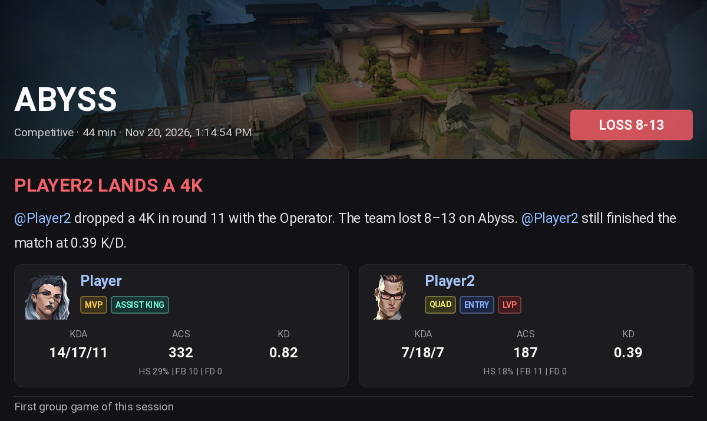

# Premier Bot

A Discord bot for a VALORANT squad. It posts match cards and rank changes automatically, shows player stats and
scoreboards, tracks the Premier schedule and results, and can write match recaps with AI.

## Getting started

You need Python 3.10+, a Discord bot token and a [HenrikDev](https://docs.henrikdev.xyz) API key.

```bash
python3 -m venv .venv
source .venv/bin/activate
pip install -r requirements.txt
cp .env.example .env
```

Fill in `DISCORD_TOKEN` and `HENRIK_API_KEY` in `.env` (and your team settings), then start the bot:

```bash
python bot.py
```

Set `GROQ_API_KEY` as well if you want AI-written recaps.

## Examples

**Match feed:** posted automatically after a squad game.



**Rank up:** posted when a linked player ranks up or deranks.


**Player history:** from `/player`.


