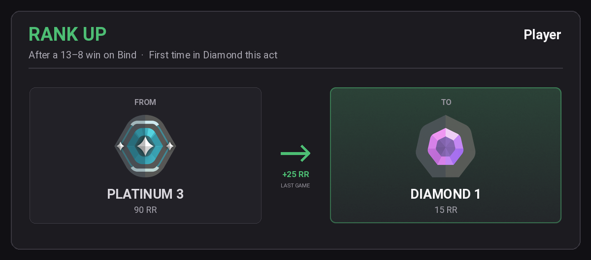
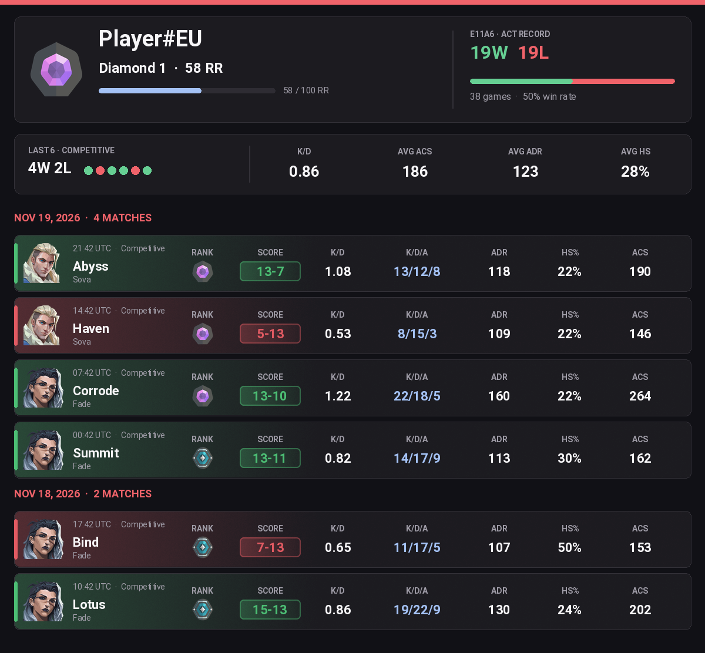

# Premier Bot

A Discord bot for a VALORANT squad. It posts match cards and rank changes automatically, shows player stats and
scoreboards, tracks the Premier schedule and results, and can write match recaps with AI.

## Getting started

You need Python 3.10+, a Discord bot token and a [HenrikDev](https://docs.henrikdev.xyz) API key.

```bash
python3 -m venv .venv
source .venv/bin/activate
pip install -r requirements.txt
cp .env.example .env
```

Fill in `DISCORD_TOKEN` and `HENRIK_API_KEY` in `.env` (and your team settings), then start the bot:

```bash
python bot.py
```

Set `GROQ_API_KEY` as well if you want AI-written recaps.

## Examples

**Match feed:** posted automatically after a squad game.


**Rank up:** posted when a linked player ranks up or deranks.



**Player history:** from `/player`.



## Commands

Run `/help` in Discord for the same list.

**Premier**

| Command | What it does |
|---|---|
| `/schedule` | Premier map schedule |
| `/results` | Premier results from the past week |
| `/mapresults` | Results and player stats on one map |
| `/scout` | A Premier team's win rate and agent picks across acts |
| `/agent`, `/clearagent` | Pick or clear your agent for a Premier map |
| `/lineup` | Team lineup and agent icons for a map |
| `/playbook` | Browse strategies by map and side |

**Players**

| Command | What it does |
|---|---|
| `/register`, `/registersmurf`, `/unregister` | Link your account, link up to two smurfs, or unlink |
| `/accounts`, `/registeredusers` | Linked accounts (yours, or everyone's in the server) |
| `/rank` | Current and peak rank |
| `/player` | Recent matches and averages |
| `/recent` | Scoreboard of the latest competitive match, with a round-by-round strip |
| `/play` | Start or stop tracking a queue session |

**Server managers**

| Command | What it does |
|---|---|
| `/matchfeed`, `/matchfeed_tone` | Set the match feed channel and the recap tone |
| `/squadlore` | Manage inside jokes the recaps can call back to |
| `/weeklyrecap`, `/testweeklyrecap` | Preview this week so far, or last week (nothing is posted) |
| `/registeruser`, `/assignagent` | Link an account or assign an agent for another member |
| `/createplaybook`, `/importplaybook`, `/importlineup` | Manage playbooks and import lineups from Google Sheets |
| `/setschedule` | Weekly queue reminder days and times |
| `/testplaycard`, `/testrankcard`, `/testreminder` | Preview cards and reminders |
| `/clearcache` | Force fresh data on the next command |

**Troubleshooting:** `/findteam` finds your team ID from a Riot ID, and `/debug` dumps raw API data.

## Match feed tags

Each player on a match feed card can earn tags. Most go to one player per match, compared across the whole team.
Gold marks big moments, green good play, purple cheeky ones and red roasts. The full rules are in
`_build_tracked` in `graphics/match_card.py`.

## Development

```bash
pip install -r requirements-dev.txt
python -m ruff check .
python -m pytest -q
```

Cards use the fonts bundled in `assets/fonts` (Roboto and Lora, SIL OFL 1.1).
